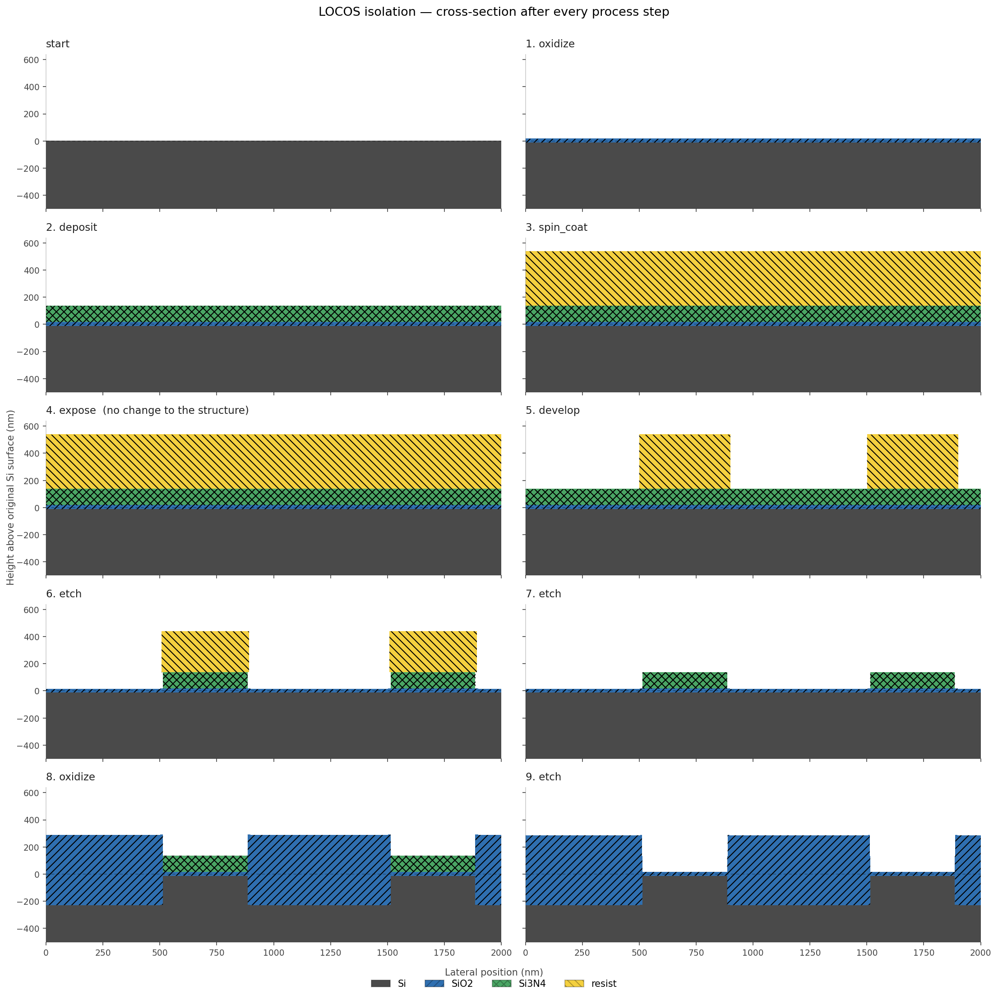

# Semiconductor Process Flow Simulator

A physically motivated simulator of the sequence of operations that turns a
bare silicon wafer into a patterned semiconductor structure.

Rather than treating fabrication as a set of unrelated calculations, the wafer
is represented as a **physical state** — a 2D cross-section of material
identities — that each process step mutates. A recipe is an ordered list of
operations, and after every one the simulator can render what the wafer now
looks like.



*The full LOCOS isolation flow, run from `recipes/locos_isolation.yaml`. Pad
oxide, nitride hard mask, lithography, nitride etch, resist strip, field
oxidation, pad strip. The nitride blocks oxygen, so thick field oxide grows
only where the pad was opened.*

## What it models

| Step | Model |
|---|---|
| Deposition | rate × time, conformal (CVD/ALD) or directional (PVD) |
| Thermal oxidation | Deal-Grove linear-parabolic kinetics, with silicon consumption |
| Lithography | spin coat, exposure to a mask or an aerial image, contrast-based development |
| Etching | per-material rates, selectivity, and a directionality parameter |
| CMP | planarisation with a polish-stop layer |

Every module states its assumptions in its docstring, and `docs/` has a page
per step covering the physics, the design decisions and the limitations.

## Validated against published data

The oxidation model is not merely plausible, it is calibrated. Against the
standard Deal-Grove charts for &lt;100&gt; silicon at 1 atm:

| condition | this simulator | published |
|---|---|---|
| wet, 1000 °C, 60 min | 388.4 nm | ~390 nm |
| dry, 1000 °C, 60 min | 58.1 nm | ~55–60 nm |

The test suite also pins the *asymptotic* behaviour — that growth goes linear
in `t` for thin films and as `√t` for thick ones — rather than only checking a
single point on the curve.

## A few things it gets right

- **Oxidation consumes the silicon it grows on.** 44% of the final oxide comes
  from below the original surface, so the Si/SiO₂ interface moves down while
  the surface moves up.
- **Growth throttles itself.** A second identical hour in the furnace grows
  388 nm the first time and only 222 nm the second, because the first film is
  now in the way.
- **Conformality is visible.** The same 40 nm film into the same trench covers
  the sidewalls at ~100% step coverage when conformal and ~12% when
  directional.
- **Resist contrast sets sidewall slope.** The same aerial image developed in
  γ = 1.5 resist gives a 450 nm sloped edge; in γ = 10 resist, 100 nm.
- **Selectivity and etch stops are the same mechanism.** A material the
  chemistry does not attack has rate zero, so it blocks the etch whether it
  sits above the film or below it.

## Setup

```bash
python3 -m venv .venv
source .venv/bin/activate
pip install -r requirements.txt
pip install -e .
```

## Run the demo

```bash
python examples/locos_flow.py        # full flow + figures + process history
python examples/step_coverage.py     # conformal vs directional deposition
python examples/resist_contrast.py   # resist contrast vs sidewall slope
```

## Tests

```bash
pytest
```

125 tests. The suite checks limiting behaviour and physical invariants, not
just return values — silicon consumption ratios, monotonicity of undercut
against directionality, that small-multiple panels share one scale, and that
copied wafers are genuinely independent.

## Status

Steps 1–5 and 7–9 of `docs/roadmap.md` are complete. Still to come: ion
implantation, process variability, the link to the companion lithography
simulator, metrology outputs, and yield statistics.

## Author

Matthew Handy — Nanoengineering, Rose-Hulman Institute of Technology
